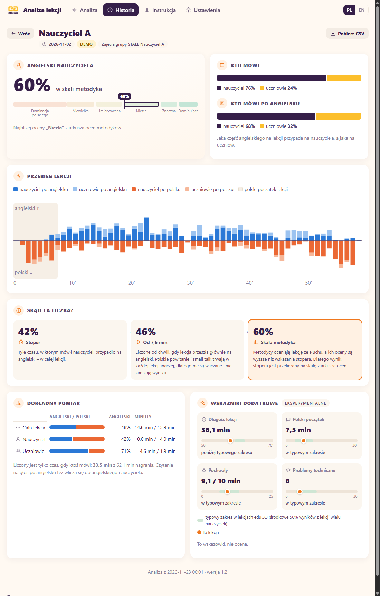

# eduGO Analiza

A small program for language-school methodologists. You paste the Dropbox link of a recorded online English lesson
(Microsoft Teams recording) and after a few minutes you see:

- how much of the lesson was in **English** and how much in **Polish**,
- the same split for the **teacher** and for the **students** (as one group),
- **who talks how much** (teacher vs. students), and how much of all the English was spoken by the students.

Everything runs on your own computer. The recording is downloaded, analysed and deleted; nothing is sent anywhere.
The interface is in Polish, because the people using it are Polish.



## Install and run

You need Windows 10/11 or a Mac (Apple M1–M4 with macOS 14+, or Intel with macOS 13+), about 2 GB of free disk space,
and an internet connection during installation. Nothing needs to be installed beforehand.

1. Download [eduGO_Analiza.zip](https://github.com/feronimus/edugo-analiza/releases/latest/download/eduGO_Analiza.zip) and unzip it anywhere (right-click → *Extract all*).
2. **Windows:** double-click `Zainstaluj_Windows.bat`.
   **Mac:** right-click `Zainstaluj_Mac.command` → **Open**.
3. Wait for `GOTOWE` (5–15 minutes the first time). An **eduGO Analiza** icon appears on the desktop.
4. Click the icon. The program opens in your browser. Paste a Dropbox link and press **Rozpocznij analizę**.

The installer puts its own Python, the libraries and the models inside the program folder, so it doesn't touch
anything else on the computer. To uninstall, delete the folder and the desktop icon. If the installation is
interrupted, run it again and it continues where it stopped.

A step-by-step guide for methodologists, in Polish, is in [JAK_ZAINSTALOWAC.txt](JAK_ZAINSTALOWAC.txt).

## How it works

The lesson goes through six steps. Each one uses a tool that is good at exactly that job.

| Step | What happens | Tool | Why this tool |
|---|---|---|---|
| 1. Get the audio | The video is downloaded from Dropbox and its sound is converted to 16 kHz mono. | **PyAV** (FFmpeg inside a Python package) | Reads any video format and needs no separate FFmpeg install. |
| 2. Find speech | Silence, typing and background noise are skipped; only stretches where someone talks are kept. | **Silero VAD** | Small, fast and very reliable voice-activity detector. |
| 3. Write down every word | Each stretch of speech is transcribed, word by word, with the time and a confidence score for every word. | **NVIDIA Parakeet TDT 0.6B v3** (through **onnx-asr**) | It writes each word in the language it was actually spoken in, even when someone switches between Polish and English in one sentence. Whisper-type models tend to translate mixed speech into one language, which would hide exactly what we want to measure. |
| 4. English or Polish? | Every word gets a label: English, Polish, neutral (names, "um") or unclear. | **wordfreq** word lists, a small letter-pattern model, and a "sentence context" step (Viterbi) | Polish letters and how common a word is in each language decide most words. Words that exist in both languages ("no", "to", "a") take the language of the sentence around them. |
| 5. Teacher or student? | Every sentence gets a voice fingerprint. The teacher's voice is learned from sentences that sound like a teacher ("słuchajcie", "can you…", "good job"), and a second time from her English classroom phrases, because many teachers use a livelier voice for those. All other voices are "students". The border between the two is set separately for each lesson. | **CAM++** voice model (3D-Speaker), run with **sherpa-onnx** | Of the voice models tested it separated teacher and children best in Teams recordings, where every voice is compressed in the same way. |
| 6. Skip played recordings | Textbook audio, videos on the slides, songs and quiz-app voices are found and left out of both teacher and students. | Our own rule on top of the voice fingerprints (see below) | No ready-made tool knew the difference between a recorded narrator and a live speaker. |

All models run on the processor through **ONNX Runtime**, so no graphics card and no PyTorch is needed. The work
is spread over several worker processes, one per processor core. That's why a 63-minute lesson takes about two
minutes on a 6-core desktop. The result is exactly the same whatever the number of cores; only the time changes.

The web page is served by **FastAPI** and **uvicorn** on `127.0.0.1`, so only the same computer can open it. The
installers use **uv** to download a private copy of Python and the exact library versions listed in
`requirements.txt`.

### How played recordings are recognised

Sentences are grouped by voice. A group is treated as a recording only if all of the following are true:

- it speaks only English,
- it is perfectly fluent (no "um", high recogniser confidence),
- the same voice never speaks Polish anywhere in the lesson,
- it does not sound like the teacher.

A live teacher or child reading English aloud always says something in Polish at some point; a recorded narrator
never does. The last rule protects teachers who speak almost only English.

### What is counted

- Speaking time, not number of words. Silence doesn't count.
- The teacher reading English aloud counts as the teacher's English.
- Played recordings, songs and app voices don't count.
- Sounds like "um", "mhm" and people's names don't count for either language.

**Why the minutes don't add up to the length of the recording.** Only the seconds when someone is actually speaking
are counted. In a typical 63-minute lesson that's about 30 minutes. The rest is made of:
- the minutes before the lesson starts,
- hundreds of short gaps between sentences,
- waiting for children to answer, typing in the chat, changing slides,
- played recordings.

Teams often records complete silence when no microphone is active.

## The methodologist's scale

Methodologists judge a lesson by ear and use the bands of their rating sheet, from "Dominacja języka polskiego" to
"Dominująca ilość języka angielskiego". Their judgement sits well above a stopwatch: a teacher who speaks English
about half of the time is usually rated "Niezła ilość języka angielskiego" (60-79%). So the main screen shows the
teacher's English **on the methodologist's scale**; the exact measurements are further down the same screen, under
*Dokładny pomiar*, and the screen shows step by step how one becomes the other.

How it is calculated (`edugo/calibration.py`):

1. **Find where this lesson really starts.** Every lesson opens in Polish (greeting, small talk, organisation) for a
   different length of time. The program finds the first two minutes in which English takes at least as much
   speaking time as Polish; that is the moment the lesson switched to English. A lesson that never switches is
   measured as a whole. The same moment is shown as "Polski początek" among the extra metrics.
2. **Measure** the teacher's English share from that moment on.
3. **Convert** it to the methodologists' scale with a curve that can only rise.

| Measured from the switch | 20% | 30% | 40% | 50% | 60% | 70% | 80% |
|---|---|---|---|---|---|---|---|
| Shown | 22% | 40% | 53% | 71% | 80% | 87% | 91% |

The curve belongs to the engine version it was made with; when the voice or language steps change, it is made
again. History stores the measured value, so old entries are always shown with the current curve.

## Accuracy

- **60 short clips sorted by hand** (who is speaking, which language, recording or not). The program agreed on 49
  of the 50 clips that had a clear answer: teacher 24/24, students 17/17, recordings 8/9.
- **Real lessons.** On eduGO lessons, the number on the methodologist's scale usually falls into the band a
  methodologist gives, or the neighbouring one. The neighbouring middle bands ("Niezła", "Znaczna") are the hardest
  to tell apart.
- **The previous program** showed higher numbers mostly because it counted Polish and silence as English (see the
  last section).

Known weak spots:

- A lesson where a student talks more than the teacher can confuse who the teacher is. The results screen warns
  when that happens.
- Single words played from a recording through the teacher's own microphone are only partly recognised as a
  recording.
- The Mac installer was checked step by step (every library has a ready build for Apple and Intel Macs at the
  required macOS versions, the scripts pass a syntax check), but it has not yet been run on a real Mac.

## Sharing it with the methodologists, and releasing updates

Methodologists don't need GitHub. Send them this link; it always downloads the newest version:

https://github.com/feronimus/edugo-analiza/releases/latest/download/eduGO_Analiza.zip

Don't attach the zip to an email: Gmail and most company mail block zip files that contain installers.

To publish a new version:
1. Commit the changes and raise `VERSION` in `edugo/__init__.py`.
2. Run these two commands:
   ```
   git archive --format=zip --prefix=eduGO_Analiza/ -o eduGO_Analiza.zip HEAD
   gh release create v1.x eduGO_Analiza.zip --title "eduGO Analiza 1.x" --notes "..."
   ```
   Keep the file name `eduGO_Analiza.zip`, so the link above keeps working. The release notes are what users see
   under "Co nowego", so write them in Polish for methodologists.
3. Installed copies see the new version the next time they start and offer a one-click update.
   It replaces only the program files (models, settings and the history stay), installs libraries only if
   `requirements.txt` changed, keeps the replaced files in `data/backup/<old version>` and puts them back if
   anything fails. Older copies are updated by downloading the zip again and running the installer once more.

## The screens

The app is one page with a menu (Analiza · Historia · Instrukcja · Ustawienia); the browser's Back button works and
nothing opens in a new tab. Analyses run in the program, not in the page, so moving between screens never stops
one; a badge in the menu shows the progress, and a finished analysis opens by itself or shows a notice with a link.
A **PL | EN** switch in the header changes every screen, including the program's messages.

- **Analiza**: paste a Dropbox link (or pick a file) and start. *Kilka nagrań naraz* takes several links, one per
  line, and queues them. Below, every analysis of the session with its progress, stage, time and a cancel button.
- **Wynik** (a finished analysis):
  - the teacher's English on the methodologist's scale, drawn on the six bands of the rating sheet;
  - *Kto mówi* (share of all speaking time) and *Kto mówi po angielsku* (of all English in the lesson, how much
    the teacher said and how much the students said);
  - *Przebieg lekcji*: minute by minute, English above the line and Polish below, teacher dark and students light,
    with the Polish opening shaded;
  - *Skąd ta liczba?*: stopwatch share over the whole lesson → share from the switch to English → methodologist
    scale;
  - *Dokładny pomiar*: English/Polish for the lesson, teacher and students, and how much of the recording is speech;
  - *Wskaźniki dodatkowe*: lesson length, Polish opening, praise per 10 minutes and technical mentions, each on a
    bar with the typical range for eduGO lessons shaded and, when History has other lessons of the same teacher,
    a ▼ for that teacher's average;
  - the CSV file button.
- **Historia**: every analysis on this computer (only the numbers and the lesson name, never the recording or the
  transcript). Filters by text, teacher, STAŁE/DEMO and date range. Teachers with two or more lessons get a tile
  with a small trend line; choosing one draws their English lesson by lesson over the rating bands. Teacher, group
  and date are read from the Teams file name ("Zajęcia grupy STAŁE <teacher> <days> <hour> z dnia <date>"); the
  group's teacher is the real one in about 84% of lessons, the rest (taken-over groups, substitutes) can be
  corrected with the pencil icon. The bin icon deletes an entry after a confirmation.
- **Instrukcja**: the user guide (`static/help.html`, Polish and English).
- **Ustawienia**: language, computer power during an analysis, opening results automatically, checking for
  updates, opening the data folder. Kept in the browser's storage on that computer.
- **Zgłoś problem** (footer): an anonymous text box. The text goes to a Google Form (no account or key needed); the
  *Problem reports* workflow in `.github/workflows/reports.yml` checks the form's answers every hour and opens a
  GitHub issue for each new report, using only the workflow's built-in token. The box is hidden while `FORM_URL`
  and `FIELD` in `edugo/feedback.py` are empty; the workflow reads the repository variable `REPORTS_CSV_URL` (the
  published CSV of the form's answers).
- **Updates**: see "Sharing it with the methodologists" above.

### Where the data is kept

Everything stays on the computer, in the `data` folder inside the program folder: `history.json` (history),
`models` (speech and voice models, about 700 MB), `server.log` (log), `backup` (the previous version after an update).
When the program folder's path has Polish letters, the installer puts the data in a folder without them and records
it in `settings.json`. The guide has a button that opens the right folder.

## Experimental extra metrics

Under *Wskaźniki dodatkowe (eksperymentalne)* the results screen shows a few extra numbers. They use only what the
program already measures (words, their times and who said them), so they cost no extra time. "Typical" is the middle
half (25th to 75th percentile) of 86 eduGO lessons by many teachers.

| Number | How it is measured | Typical in eduGO lessons |
|---|---|---|
| Lesson length | from the first to the last spoken sentence | 59-62 min |
| Polish opening | from the first words until the first two minutes that are mostly English (greeting, small talk, organisation) | 4-11.5 min |
| Praise and short feedback | phrases like "good job", "excellent", "brawo" by the teacher, per 10 minutes | 6-13 |
| Talk about technical problems | phrases like "nie słychać", "can you hear me", "kamera" | 4-13 |

## The previous version and why it was replaced

The first eduGO Analiza cut the lesson into pieces of up to 4 seconds and asked OpenAI Whisper (the *tiny*
model) which language each piece was in. An optional second step used pyannote to separate speakers. It had four
problems:

- **One language per 4-second piece.** A sentence like *"Dobrze, so open your books"* became all-Polish or
  all-English. On a test lesson it reported 64 % English where careful checking found about 46 %.
- **No English/Polish split for teacher and students.** The speaker step only measured how long each side
  talked, not in which language.
- **Slow.** About 9 minutes per lesson for the language part, plus about 32 minutes for the speaker part.
- **Hard to install.** The Windows package installed unpinned library versions and no longer started after a
  fresh install. The Mac package contained a Windows copy of Python. The speaker model needed a Hugging Face
  access token stored in the code.

This version measures every word instead of 4-second pieces, splits the result by teacher and students, skips
played recordings, needs no tokens or accounts, and takes about 2 minutes on the same computer.

## Project layout

```
server.py              the local web app (start with: python server.py --open)
static/index.html      the page shell (header, menu); everything else is drawn by the scripts below
static/css/app.css     the look of all screens
static/js/app.js       menu, screens and the browser's Back button, progress badge, update banner
static/js/jobs.js      watches the running analyses
static/js/api.js       calls to the local program
static/js/i18n.js      Polish/English texts and the program's messages in English
static/js/ui.js        number formats and the graphics (band scale, timeline, gauges, trend)
static/js/icons.js     the small line icons
static/js/views/       one file per screen: analysis, result, history, help, settings, report
static/help.html       the user guide
edugo/audio.py         Dropbox download and audio decoding
edugo/analyzer.py      speech detection, transcription and voice fingerprints, in parallel worker processes
edugo/language.py      English/Polish label for every word
edugo/voices.py        teacher vs. students
edugo/recordings.py    finding played recordings
edugo/results.py       the percentages shown on screen
edugo/calibration.py   the switch to English and the methodologist's scale
edugo/config.py        folders and model download
edugo/updates.py       checking GitHub for a new version and the one-click update
edugo/history.py       the list of earlier analyses
edugo/feedback.py      anonymous problem reports
.github/               the workflow that turns problem reports into issues
install/               installer scripts
Zatrzymaj_eduGO.*      stop the program (Windows .bat, Mac .command)
```

To run it from source with your own Python 3.13: `pip install -r requirements.txt`, then `python server.py --open`.

## Models and licences

The models are downloaded from their original sources during installation and are not part of this repository.
Check each licence on the model's own page before any commercial use.

| Model | Source | Licence (as published) |
|---|---|---|
| NVIDIA Parakeet TDT 0.6B v3 | https://huggingface.co/nvidia/parakeet-tdt-0.6b-v3 | CC-BY-4.0 |
| Silero VAD | https://github.com/snakers4/silero-vad | MIT |
| 3D-Speaker CAM++ | https://github.com/modelscope/3D-Speaker | Apache-2.0 |
| wordfreq word lists | https://github.com/rspeer/wordfreq | CC-BY-SA 4.0 (data) |
